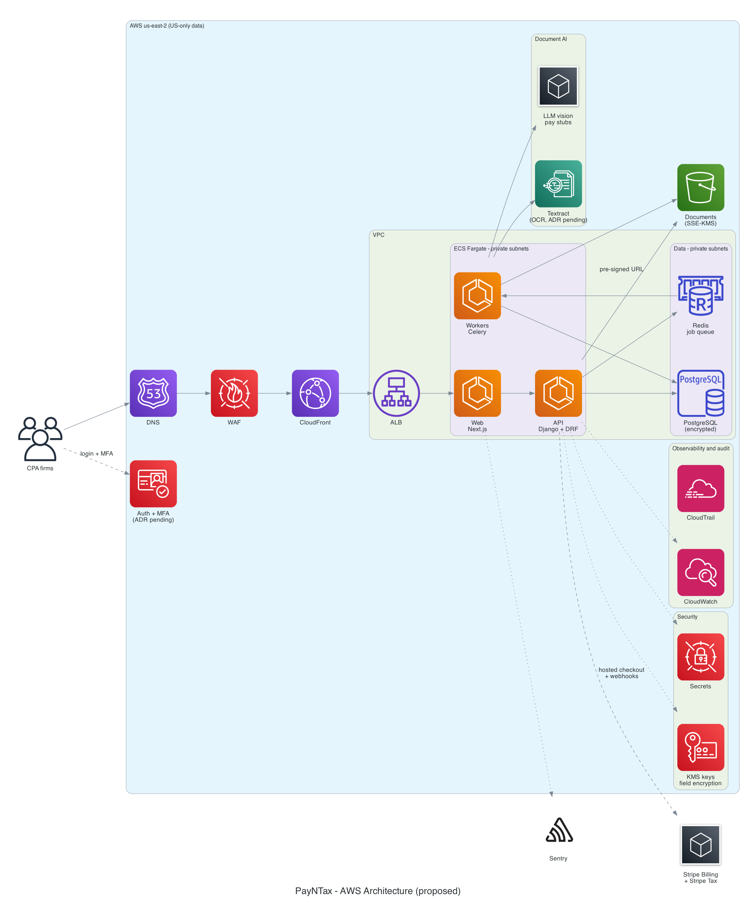
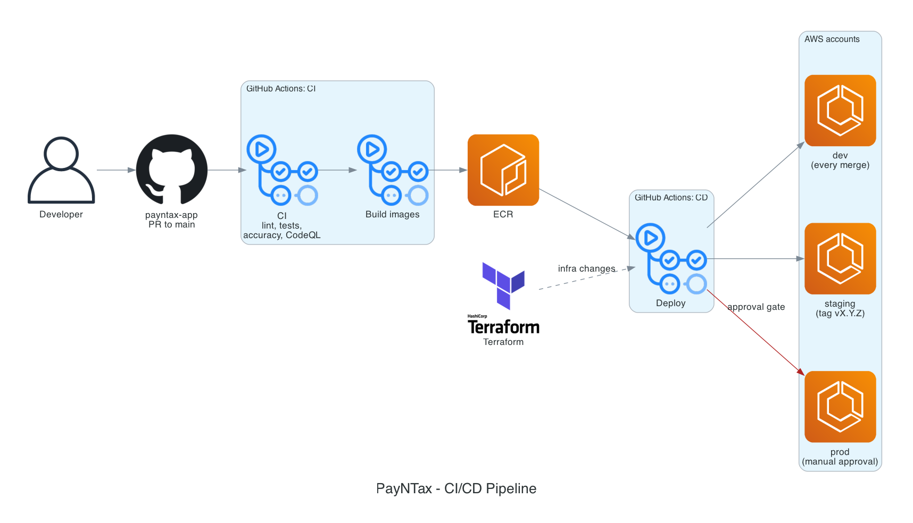
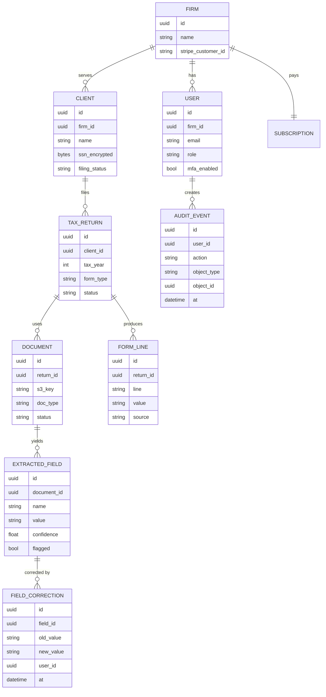

# Architecture

**Status: proposed.** Items marked "ADR pending" are open decisions in the [TODO list](../delivery/TODO.md#open-decisions).

## Diagram conventions

| Diagram type | Tool | Source |
|---|---|---|
| Cloud and infrastructure (AWS icons) | [Diagrams](https://diagrams.mingrammer.com/) (Python) | [`diagrams/*.py`](../../diagrams), rendered to `docs/assets/*.png` by `make diagrams` and CI |
| Sequences, flows, states, data model, timeline | [Mermaid](https://mermaid.js.org/) | Written inside the Markdown; GitHub and the docs site render it |
| Screen layouts | Text wireframes | [docs/screens](../screens/README.md) |

Why two tools: see [ADR-0001](adr/0001-diagrams-as-code.md).

## AWS architecture

| Component | Choice | Notes |
|---|---|---|
| Edge | Route 53, WAF, CloudFront | TLS 1.2+, rate limiting, AWS managed rule sets |
| Web | Next.js on ECS Fargate | Server-side rendering; no client data cached at the CDN |
| API | Django + DRF on ECS Fargate | Tenant scoping on every query (firm ID) |
| Workers | Celery on ECS Fargate, Redis (ElastiCache) as broker | Classify, extract, validate, fill PDFs |
| Database | RDS PostgreSQL, Multi-AZ in prod, encrypted | Field-level encryption for SSN, EIN, bank numbers |
| Documents | S3 with SSE-KMS, block public access, versioning | Upload and download through short-lived pre-signed URLs |
| OCR | AWS Textract (ADR pending vs Azure Document Intelligence) | Decided by the S3.3 accuracy spike |
| Pay stubs | LLM vision model with schema-validated output | No client data retained for training (IRC §7216) |
| Auth | Cognito, Auth0 or Clerk (ADR pending) | MFA required for every user |
| Billing | Stripe Billing + Stripe Tax, hosted checkout | Card data never touches our servers (PCI SAQ A) |
| Secrets and keys | Secrets Manager, KMS | Separate keys per environment |
| Observability | CloudWatch, CloudTrail, Sentry | Logs scrubbed of SSN and EIN patterns |
| Region | US only (us-east-2 proposed) | Data residency requirement |

## CI/CD

See [delivery plan §5](../delivery/delivery-plan.md#5-branching-and-releases) for branching and environments.

## Data model (first draft)

The upload-to-1040 sequence and document lifecycle are in [screens](../screens/README.md#main-user-flow-from-upload-to-1040).

## Architecture Decision Records

Decisions are recorded in [`adr/`](adr). Copy [the template](adr/0000-template.md) to `adr/NNNN-short-title.md`.

| ADR | Title | Status |
|---|---|---|
| [0001](adr/0001-diagrams-as-code.md) | Diagrams as code: Diagrams for cloud, Mermaid for the rest | Accepted |
| [0002](adr/0002-application-stack.md) | Application stack: Django, Next.js, PostgreSQL, AWS | Proposed |
| 0003 | Auth provider | Pending (TODO D2) |
| 0004 | OCR provider | Pending (TODO D3) |
| 0005 | Background jobs: Celery or Temporal | Pending (TODO D4) |
