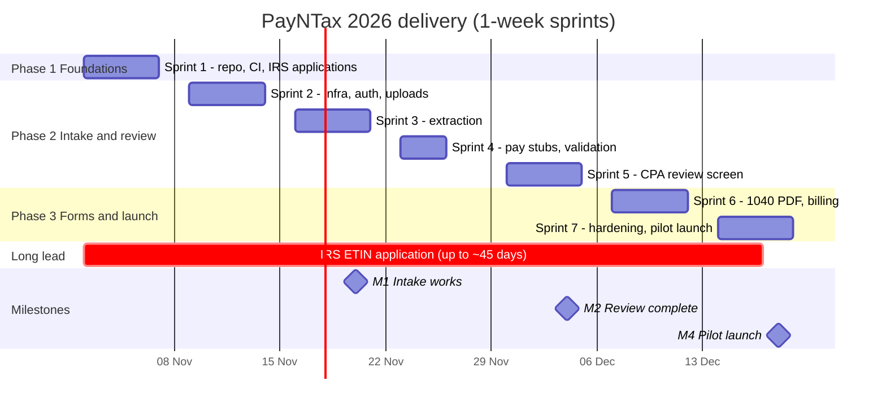
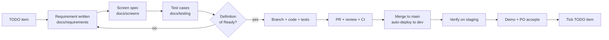
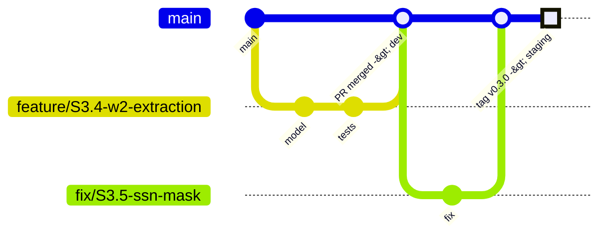

# Delivery Plan and Project Workflow

How the team turns the [TODO list](TODO.md) into working, shipped software.

## 1. Team and roles

Team of 2–4. One person can hold more than one role.

| Role | Short | Responsibilities |
|---|---|---|
| Product owner | PO | Priorities, requirements, acceptance, compliance and business tasks, pilot CPAs |
| Backend developer | BE | Django API, extraction pipeline, data model, security controls |
| Frontend developer | FE | Next.js screens, forms, accessibility |
| QA / DevOps | QA | Test strategy, synthetic data, CI/CD, AWS and Terraform, monitoring |

Every PR needs a reviewer other than its author. Security-sensitive code (auth, encryption, audit log, SSN handling) needs a review from BE plus one more person.

## 2. Timeline

## 3. Sprint rhythm (1-week sprints, Monday to Friday)

| When | Meeting | Length | Output |
|---|---|---|---|
| Monday 10:00 | Sprint planning | 45 min | Sprint items picked from TODO.md, each meeting the Definition of Ready |
| Daily | Stand-up (async in chat is fine) | 10 min | Blockers raised |
| Wednesday | Backlog refinement | 30 min | Next sprint's items get requirements, screens, and acceptance criteria |
| Friday 14:00 | Demo | 30 min | Working software shown on `dev` or `staging` |
| Friday 14:30 | Retrospective | 15 min | One thing to change next week |

The PO updates the milestone table in [TODO.md](TODO.md) after each demo.

## 4. How a work item flows

Every item is traceable: **Requirement ID → Screen ID → Test case ID → PR**. For example `REQ-REV-001 → SCR-08 → TC-REV-001 → PR`.

### Definition of Ready

- [ ] Requirement has an ID and acceptance criteria ([requirements](../requirements/README.md))
- [ ] Screen spec exists if there's UI ([screens](../screens/README.md))
- [ ] Test approach noted ([test strategy](../testing/test-strategy.md))
- [ ] Small enough to finish in one sprint
- [ ] Dependencies and open decisions are resolved

### Definition of Done

- [ ] Code merged to `main` through a reviewed PR with green CI
- [ ] Unit tests and, where relevant, integration or E2E tests added
- [ ] No real taxpayer data in code, tests, fixtures, or logs
- [ ] SSN, EIN and bank numbers encrypted and masked in the UI and logs
- [ ] Audit log entries for any view or edit of client data
- [ ] Deployed to `dev` and checked on `staging`
- [ ] Docs updated: requirement status, screen spec, ADR if a decision was made
- [ ] PO accepted it at the demo

## 5. Branching and releases

**Trunk-based development** with short-lived branches. It suits a small team with weekly demos.

- Branch names: `feature/<TODO-id>-short-name`, `fix/<TODO-id>-short-name`, `chore/...`
- Commit messages follow Conventional Commits: `feat:`, `fix:`, `docs:`, `test:`, `chore:`
- Branches live 1–3 days at most. Merge with squash.
- Unfinished features hide behind feature flags rather than long branches.

### Environments

| Environment | Deploys when | Data | Who uses it |
|---|---|---|---|
| `local` | Developer runs `docker compose up` | Synthetic only | Developers |
| `dev` | Every merge to `main` | Synthetic only | Team |
| `staging` | Git tag `vX.Y.Z` | Synthetic only | Demos, UAT |
| `prod` | Manual approval in GitHub Actions environment | Real client data | Pilot CPAs |

Production deploys need approval from the PO and one engineer. Each release has a short changelog and a rollback plan (previous container image plus database migration notes).

## 6. Risk register

| Risk | Likelihood | Impact | Mitigation |
|---|---|---|---|
| ETIN not approved before 2027 filing season | Medium | E-file slips | Apply in week 1; December launch doesn't depend on e-file (PDF download) |
| OCR accuracy too low on scanned W-2s | Medium | More CPA corrections | Confidence flags plus review screen; compare providers in S3 |
| 1040 calculation errors | Medium | High (liability) | Limit to W-2-only returns at launch; golden-return tests; CPA signs off every return |
| Data breach | Low | Very high | WISP, encryption, MFA, audit log, least privilege, pen test |
| Small team, tight 7 weeks | High | Scope slips | Weekly demos; cut scope, not quality; launch-blocking bugs only in S7 |

## 7. Where things live

| What | Where |
|---|---|
| Plans and decisions history | [docs/planning](../planning) |
| TODO list and this workflow | [docs/delivery](.) |
| Development setup | [docs/setup](../setup/development-setup.md) |
| Requirements | [docs/requirements](../requirements/README.md) |
| Screen specs and flows | [docs/screens](../screens/README.md) |
| Test strategy | [docs/testing](../testing/test-strategy.md) |
| Architecture and ADRs | [docs/architecture](../architecture/README.md) |
| Diagram source (Python) | [diagrams/](../../diagrams) |
