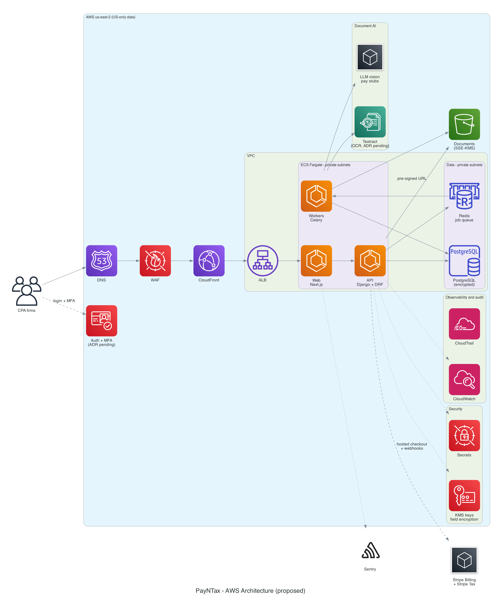

# PayNTax Engineering Docs

Tax prep for solo CPAs: scan W-2s and pay stubs, extract fields, CPA reviews, fill the 1040. Pilot launch **18 Dec 2026**; e-file and business returns in 2027; payroll later.

## Start here

| | |
|---|---|
| 📋 [TODO list](delivery/TODO.md) | Every task by phase and sprint, with owners and milestones |
| 🔁 [Delivery plan](delivery/delivery-plan.md) | Sprint rhythm, workflow, Definition of Done, branching, environments, risks |
| 🛠 [Development setup](setup/development-setup.md) | Tools, local stack, secrets and data rules, onboarding checklist |
| 📝 [Requirements](requirements/README.md) | Functional and non-functional requirements with IDs |
| 🖥 [Screens](screens/README.md) | Screen inventory, navigation, user flows, wireframes |
| ✅ [Test strategy](testing/test-strategy.md) | Test levels, synthetic data, extraction accuracy, traceability |
| 🏗 [Architecture](architecture/README.md) | AWS architecture, CI/CD, data model, ADRs |
| 📂 [Planning notes](planning/01-kickoff-notes.md) | Kickoff notes and [draft plan](planning/02-draft-plan.md) |

## Core system architecture

Diagrams are code: Python files in `diagrams/` (cloud, with AWS icons) and Mermaid inside these Markdown pages (flows, sequences, data model).
