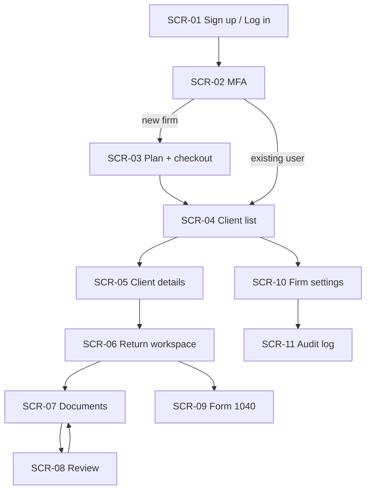
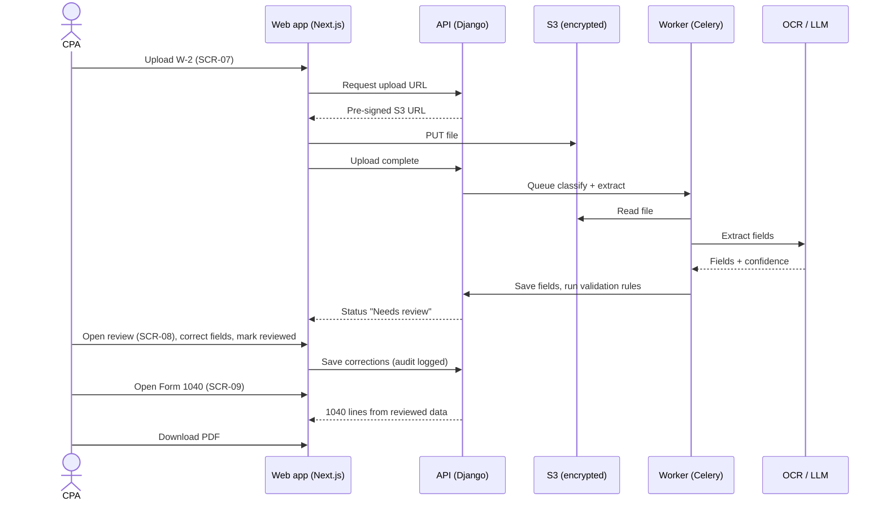
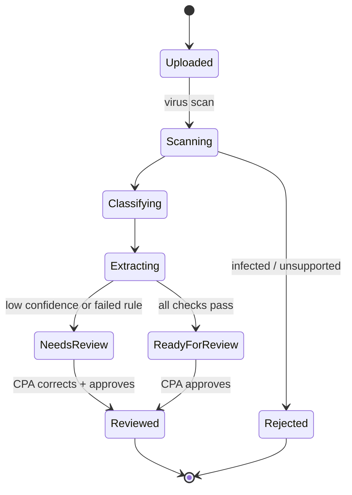

# Application Screens

Screen inventory, navigation flow, and screen specs. Navigation and user flows use Mermaid. Layouts are low-fidelity text wireframes, which are quick to change and diff well in PRs. Add higher-fidelity mock-ups later as images in `docs/screens/img/`.

## Screen inventory

| ID | Screen | Requirements | Sprint |
|---|---|---|---|
| SCR-01 | Sign up / Log in | REQ-ACC-001 | S2 |
| SCR-02 | MFA setup and challenge | REQ-ACC-002 | S2 |
| SCR-03 | Choose plan and checkout (Stripe hosted) | REQ-BIL-001, 002 | S6 |
| SCR-04 | Client list (firm dashboard) | REQ-CLI-001 | S2 |
| SCR-05 | Client details | REQ-CLI-001 | S2 |
| SCR-06 | Return workspace (client + tax year) | REQ-CLI-002 | S6 |
| SCR-07 | Documents: upload and status | REQ-DOC-001, 003 | S3–S4 |
| SCR-08 | Document review (side by side) | REQ-EXT-*, REQ-REV-* | S5 |
| SCR-09 | Form 1040 view, edit and download | REQ-FRM-* | S6 |
| SCR-10 | Firm settings: users, MFA, billing | REQ-ACC-003, REQ-BIL-003 | S6 |
| SCR-11 | Audit log | REQ-SEC-001 | S7 |

## Navigation



## Main user flow: from upload to 1040



## Document status lifecycle



## Screen specs

### SCR-07 Documents: upload and status

```text
┌────────────────────────────────────────────────────────────────────┐
│ PayNTax   Clients > Jane Doe > 2026 Return > Documents      [User▾]│
├────────────────────────────────────────────────────────────────────┤
│  ┌──────────────────────────────────────────────┐                  │
│  │   Drag & drop W-2s and pay stubs here        │                  │
│  │   or [Browse files]   PDF · JPG · PNG ≤20 MB │                  │
│  └──────────────────────────────────────────────┘                  │
│  File                  Type       Status            Uploaded       │
│  ───────────────────────────────────────────────────────────────── │
│  acme_w2.pdf           W-2        ● Needs review    2 min ago  [▶] │
│  stub_dec.jpg          Pay stub   ● Ready to review 5 min ago  [▶] │
│  scan_003.png          —          ◌ Extracting…     just now       │
└────────────────────────────────────────────────────────────────────┘
```

- Multiple files at once; progress bar per file.
- Status updates without page reload (polling or server-sent events).
- Errors: unsupported type, too large, virus found, extraction failed (with Retry).

### SCR-08 Document review (side by side)

```text
┌────────────────────────────────────────────────────────────────────┐
│ ← Documents     acme_w2.pdf · W-2 · 2026            [Mark reviewed]│
├───────────────────────────────┬────────────────────────────────────┤
│                               │ Employer EIN   12-3456789      ✓   │
│                               │ Employer       Acme Corp       ✓   │
│    [ document image ]         │ Employee SSN   ***-**-6789     ✓   │
│    zoom +/−, rotate, page 1/1 │ Box 1 Wages    [ 85,000.00 ]   ⚠ 72%│
│    clicking a field outlines  │ Box 2 Fed tax  [ 12,410.00 ]   ✓   │
│    its location on the image  │ Box 3 SS wages [ 85,000.00 ]   ✓   │
│                               │ Box 4 SS tax   [  5,720.00 ]   ⚠   │
│                               │ ⚠ Box 4 should be 6.2% of Box 3     │
│                               │   (expected 5,270.00)               │
├───────────────────────────────┴────────────────────────────────────┤
│ 2 fields need attention        [Previous doc]  [Save]  [Next doc]  │
└────────────────────────────────────────────────────────────────────┘
```

- Fields below the confidence threshold (default 90%) or failing a rule get ⚠ and come first in tab order.
- SSN is masked; "show" is allowed for Owner and Preparer and is audit logged.
- "Mark reviewed" is disabled while any ⚠ remains unacknowledged.
- Keyboard: Tab between fields, Enter to accept, Ctrl+S to save.

### Template for a new screen

```markdown
### SCR-NN Screen name
- **Requirements:** REQ-..
- **Users / roles:**
- **Entry points:** (which screens link here)
- **Layout:** (text wireframe in a ```text block)
- **Fields and validation:**
- **Actions and results:**
- **Empty, loading and error states:**
- **Audit events:**
- **Accessibility notes:**
- **Test cases:** TC-..
```
