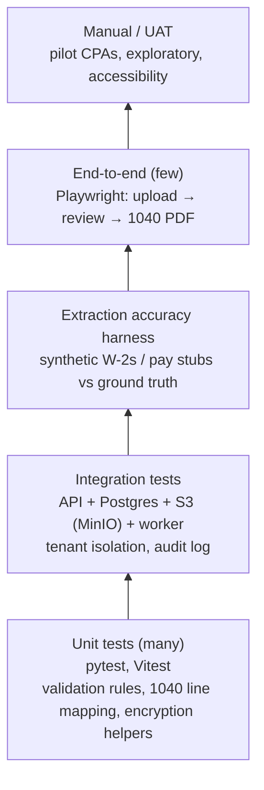

# Test Strategy

Goal: CPAs can trust the numbers, and client data stays safe. Testing focuses on three risks: **wrong extracted values, wrong 1040 values, and data exposure**.

## 1. Test levels

| Level | Tool | Runs | Owner | Gate |
|---|---|---|---|---|
| Unit | pytest, Vitest | Every PR | Author | ≥ 80% line coverage on `extraction`, `returns`, `audit`, `crypto` modules |
| Integration | pytest + docker compose services | Every PR | BE | All pass |
| Contract / API | DRF schema (OpenAPI) + schemathesis | Every PR | BE | No breaking changes without version bump |
| Extraction accuracy | Custom harness on synthetic set | Every PR touching extraction; nightly | QA | ≥ 98% exact fields on W-2 set (NFR-ACC-001); no drop > 1 point |
| Golden returns | pytest with known input → expected 1040 | Every PR | BE, QA | 100% match |
| End-to-end | Playwright | On merge to `main` (against `dev`) | QA | All pass before tagging a release |
| Security | gitleaks, Dependabot, CodeQL, OWASP ZAP baseline | Every PR; ZAP weekly on `staging` | QA | No high or critical findings |
| Performance | k6 | Before launch, then monthly | QA | NFR-PERF targets |
| Accessibility | axe-core in Playwright + manual keyboard check | Every release | FE | No serious WCAG 2.1 AA issues |
| UAT | Pilot CPAs on `staging` | S5 demo, S7 | PO | Sign-off at go/no-go |

## 2. Test data: synthetic only

No real taxpayer documents, ever (IRS Pub 4557, FTC Safeguards Rule).

- **W-2 generator** (TODO S2.6): random but valid-looking employers, employees, amounts that follow the box rules. Produces a clean PDF, a "scanned" image (skew, blur, noise, stamps), and `ground_truth.json`.
- **Pay stub generator** (TODO S4.3): several ADP-style layouts, with YTD values consistent with the matching W-2.
- **Invalid cases on purpose:** wrong box math, bad SSN format, missing employer EIN, rotated and multi-page scans, low resolution, non-tax documents.
- SSNs come from the ranges that are never issued (for example starting with 9xx or 000) so they can't belong to anyone.
- Data sets are versioned in `testdata/` with a manifest; accuracy reports name the version.

## 3. Extraction accuracy

For every field in the synthetic set the harness records **exact match**, **normalized match** (formatting differences only), or **miss**, and whether the confidence flag was right:

| Measure | Meaning | Target |
|---|---|---|
| Field accuracy | Exact or normalized matches ÷ all fields | ≥ 98% (W-2), ≥ 95% (pay stubs) |
| Flag recall | Wrong fields that were flagged ⚠ ÷ all wrong fields | ≥ 99%; a wrong value must almost never look certain |
| Flag precision | Flagged fields that were really wrong | Track it; too many flags slow CPAs |

Flag recall matters most: the review screen is our safety net, so wrong values must be flagged.

## 4. Traceability

Test case IDs mirror requirement areas: `TC-<AREA>-<NNN>`. Each test case names the requirement it covers.

| Test case | Requirement | Level | Description |
|---|---|---|---|
| TC-ACC-001 | REQ-ACC-002 | E2E | User without MFA can't open any client page |
| TC-SEC-001 | NFR-SEC-004 | Integration | Firm A token gets 404 on firm B's client, document and return URLs |
| TC-SEC-002 | NFR-SEC-001 | Integration | SSN column is ciphertext in Postgres; logs never contain an SSN pattern |
| TC-DOC-001 | REQ-DOC-001 | E2E | Upload 3 files at once; 25 MB file is rejected with a message |
| TC-DOC-002 | REQ-DOC-002 | Integration | EICAR test file is rejected and never reaches extraction |
| TC-EXT-001 | REQ-EXT-001 | Accuracy | W-2 synthetic set meets field accuracy target |
| TC-EXT-002 | REQ-EXT-003 | Unit | Box 4 ≠ 6.2% of Box 3 (within rounding, under wage base) raises a rule warning |
| TC-REV-001 | REQ-REV-003 | Integration | Correction stores original and new value, user and timestamp in audit log |
| TC-REV-002 | REQ-REV-004 | E2E | "Mark reviewed" is disabled while a ⚠ field is unacknowledged |
| TC-FRM-001 | REQ-FRM-001 | Golden | Single W-2, single filer → expected 1040 lines 1a and 25a |
| TC-FRM-002 | REQ-FRM-001 | Golden | Two W-2s, married filing jointly → wages and withholding summed |
| TC-BIL-001 | REQ-BIL-001 | E2E | Stripe test-mode checkout creates an active subscription |

## 5. Environments and test data

| Environment | Tests run there | Data |
|---|---|---|
| CI | Unit, integration, accuracy, golden | Synthetic, created per run |
| `dev` | E2E after each merge | Synthetic seed |
| `staging` | E2E, ZAP, k6, UAT | Synthetic seed; Stripe test mode |
| `prod` | Smoke test after deploy (log in, open a demo client) | Real data; a dedicated demo firm for smoke tests |

## 6. Defects

| Severity | Example | Response |
|---|---|---|
| S1 Critical | Data exposure, wrong 1040 amount without a flag | Stop the line; fix before anything else; incident process if in prod |
| S2 High | Upload or review broken for some documents | Fix this sprint |
| S3 Medium | Wrong flag, confusing message | Backlog, prioritized by PO |
| S4 Low | Cosmetic | Backlog |

Every S1 or S2 fix adds a regression test.

## 7. Release exit criteria (pilot launch, 18 Dec)

- [ ] All Must requirements have passing tests
- [ ] Extraction accuracy targets met on the latest synthetic set
- [ ] Golden returns 100%
- [ ] No open S1 or S2 defects
- [ ] ZAP baseline: no high findings; dependency scan clean of criticals
- [ ] Backup restore tested on `staging`
- [ ] Pilot CPA UAT sign-off

## 8. 2027: IRS ATS

For e-file, the IRS publishes ATS test scenarios for each return type and tax year. Each scenario becomes a golden-return test plus an MeF XML schema validation test, and all must pass before submitting to ATS.
